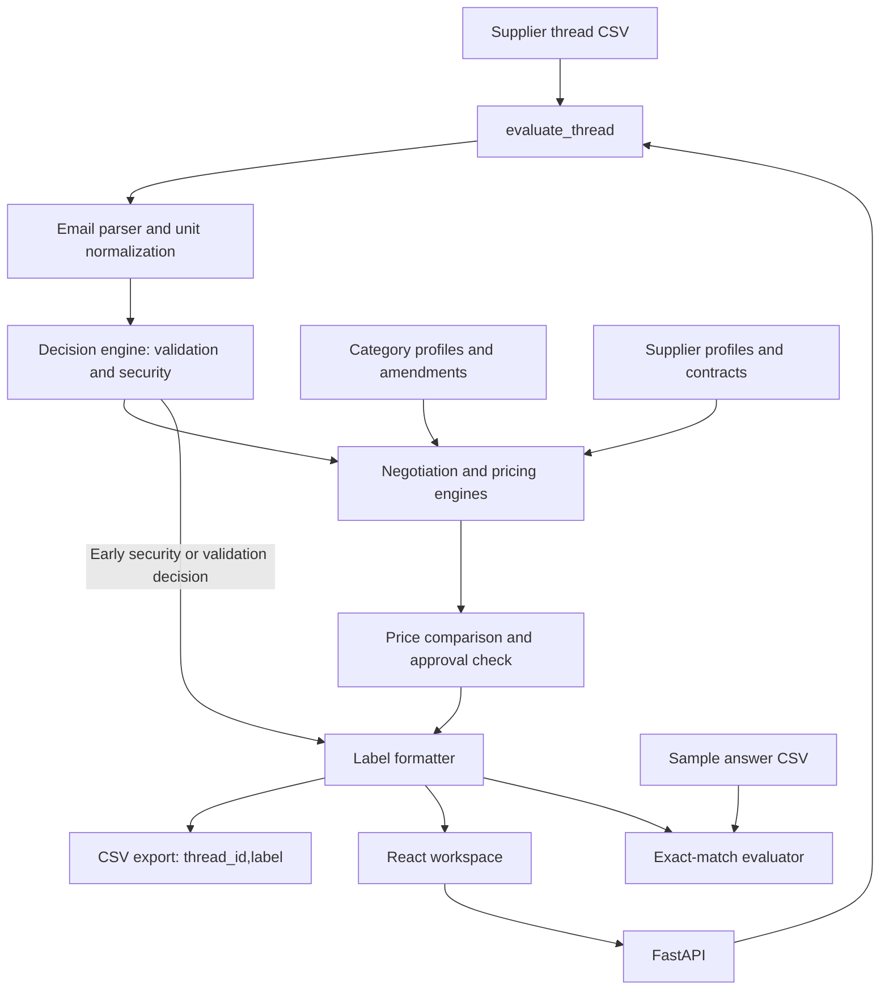

# NexDeal — Procurement Intelligence Workspace

A policy-driven procurement negotiation agent for the **The Procurement Desk** challenge. NexDeal converts supplier email threads into reproducible commercial decisions using structured policy data, deterministic text extraction and mathematical negotiation rules.

> **Submission disclosure:** The selected Kaggle CSV was generated with the team-created `playbook(3).zip`, not the unchanged organizer playbook. Comparison against the organizer archive found 46 of 80 Markdown files changed (37 supplier profiles and 9 amendments). Organizer authorization for these changes has not been established. The reported Kaggle score is 1/1; independent reproduction of the submitted CSV does not establish compliance or hidden-test accuracy.

## 1. Overview

Each input thread supplies a supplier, category, quantity, date, negotiation round and email conversation. The agent identifies the current commercial offer, normalizes its price, resolves applicable category amendments and supplier contracts, checks security and contractual restrictions, and selects one of four actions: ACCEPT, COUNTER, REJECT or ESCALATE.

The React/Vite workspace provides overview, batch processing and decision history. FastAPI exposes the negotiation engine and CSV export. The offline generator is the reference path for reproducing the competition submission.

## 2. Mathematics

### Price normalization

Let `a` be the extracted monetary amount, `u` the unit divisor, `b` the billing conversion factor, `m` paid units, `f` free units, `e` the INR exchange rate, `d` an eligible percentage discount, `q` the order quantity and `g` the GST percentage.

The parser computes `p = (a/u) × m/(m+f) × b` when the corresponding adjustments apply. Otherwise the free-unit and billing factors are 1.

| Conversion | Implemented rule |
|---|---|
| Dozen | Divide by 12 |
| Explicit bulk or pack | Divide by quoted count |
| LED pack without count | Divide by 4 |
| Printer paper per ream | Divide by 0.1 (10 reams per normalized box) |
| Box or single item | Divide by 1 |
| Free units | Multiply by paid / (paid + free) |
| Monthly to annual | Multiply by 12 |
| Annual to monthly | Divide by 12 |
| Numeric suffixes | k/thousand × 1,000; lakh × 100,000; million × 1,000,000; crore × 10,000,000 |

The decision engine then applies these operations in order:

1. `P = p × e`.
2. If a discount is applicable, `P = P × (1 - d/100)`. A quantity-conditioned discount is removed when `q` is below its threshold.
3. If the offer is a total price, `P = P/q`.
4. If GST is included, `P = P/(1 + g/100)`.

Default exchange rates in INR per foreign currency unit: INR 1, USD 84.5, EUR 91, GBP 106. A recognized supplier contract exchange rate replaces the corresponding default. These are fixed policy rates, not live FX quotes.

### Negotiation concession schedule

Let `T` be target price, `W` walk-away price, `R` total rounds, `r` current round, and `β` the concession exponent. Date-effective amendments update category parameters before the calculation. A matching supplier contract cap `C` replaces `W`.

```math
L(r)=T+(W-T)\left(\frac{r-1}{R-1}\right)^\beta
```

For probation, the pricing engine starts with `L = T`. For a single-round non-probation negotiation, `L = W`. Otherwise it uses the equation above. A contract cap additionally bounds the pricing result by `min(L,C)`. The negotiation engine uses `min(L,W)`, except at the final round with a contract cap where it uses `W`; probation then bounds the result by `T`. Valid rounds are 1 through R.

Counter price is the final limit rounded to a whole rupee using Decimal `ROUND_HALF_UP`. The unrounded limit is used for price comparisons. Decimal arithmetic is used in the negotiation and price normalization stages; the category loader initially parses numeric fields as floats before conversion to Decimal.

### Approval and decision rules

After validation, blacklist and security checks, compare the normalized unit price `P` with the final limit `L`:

- `P > L` and `r < R`: COUNTER at the rounded limit.
- `P > L` and `r >= R`: REJECT.
- `P <= L`: compute total order value `V = P × q`. If `V > A`, where `A` is the approval limit, ESCALATE; otherwise ACCEPT.

Approval is checked only after the offer passes the price test. Exact equality with the limit is acceptable; exact equality with the approval limit does not trigger escalation.

## 3. Architecture



The optional Gemini experiment is not part of this execution path.

## 4. Implementation

| Module | Responsibility |
|---|---|
| `backend/email_parser.py` | `extract_email_data`, `extract_price`, `extract_discount`, unit, billing and free-unit normalization |
| `backend/category_loader.py` | `load_categories`: parse category Markdown |
| `backend/supplier_loader.py` | `load_suppliers`: parse supplier name, status and contract |
| `backend/amendment_engine.py` | `get_category_rules`: apply amendments effective on or before thread date, in date and ID order |
| `backend/contract_engine.py` | `get_contract_rules`: category-specific cap and contract FX overrides |
| `backend/pricing_engine.py` | `calculate_limit`, `round_rupee` |
| `backend/negotiation_engine.py` | `calculate_negotiation_limit`: combine pricing and commercial restrictions |
| `backend/decision_engine.py` | `make_decision`, security detectors and `make_label` |
| `backend/accuracy_test.py` | `evaluate_thread` and exact-match sample evaluation |
| `backend/generate_submission.py` | Validate and generate the 2,000-row submission |
| `backend/gemini_analyzer.py` | Standalone experimental language extraction |
| `backend/main.py` | FastAPI service and static frontend hosting |

Category, supplier and amendment loaders cache parsed data and return copies. The backend provides `GET /health`, `POST /analyze`, `POST /batch`, `POST /export` and `POST /process-csv`. The raw-email API path reuses `evaluate_thread`; structured-price requests can call the decision engine directly. The submission generator validates label format and unique IDs and refuses to write a new submission if processing errors are detected.

## 5. AI models, APIs and cost

The final CSV pipeline uses no external model calls. The optional `analyze_supplier_message` function calls Google Gemini `gemini-2.5-flash` once per invocation, with temperature 0 and JSON response MIME type. Its prompt treats supplier messages as untrusted data, requests factual price, currency, unit, billing, GST, discount and security fields, and explicitly prohibits final action decisions. The complete prompt is in `backend/gemini_analyzer.py`.

The team reports using the Gemini free tier with zero API expenditure. The historical number of experimental calls was not recorded. Generation of the final CSV requires zero Gemini calls and no API key. If running the optional standalone experiment, configure `GEMINI_API_KEY` privately in `backend/.env`; never commit credentials.

## 6. Tricky cases

- **Prompt injection:** regex checks full conversation and latest message for manipulation patterns, including selected English, Hindi and Hinglish phrases. Ordinary AI product descriptions are not inherently attacks.
- **Banned terms:** checks latest message for automatic renewal, forced exclusivity, unlimited liability and advance payments above 30%, with limited handling of explicit negations.
- **Precedence:** missing or invalid required information, blacklist, prompt injection, banned terms, price decision, then approval. A higher-priority decision may mask a later issue.
- **Amendments:** only matching category amendments effective by the thread date apply; later applicable values overwrite earlier ones.
- **Contracts:** recognized category-specific caps replace the category walk-away price; recognized contract FX rates override defaults. Probation restricts concessions.
- **Trading names:** supplier lookup uses the supplied name with whitespace trimming and case folding. There is no general trading-name alias resolution; unknown names can require escalation.
- **Currencies:** INR, USD, EUR and GBP are supported; other recognized currency tokens are not accepted for pricing.
- **Corrections and multiple prices:** quantity tiers, explicit ranges (higher endpoint), corrections, revised offers, explicit unit prices and previous-quote discounts receive special handling. Unmatched multi-price messages fall back to the last recognized offer.
- **Ambiguity:** unresolved discounts or billing periods produce review flags. The batch generator stops on unresolved commercial review flags except for permitted security or missing-information decisions.

## 7. Evaluation and reproducibility

| Metric | Result |
|---|---|
| Selected Kaggle file | `nexdeal_predictions1.csv` |
| Kaggle score | 1/1 (team-reported; not independently verified on Kaggle) |
| Original sample exact-match | 30/40 = 75% |
| Incorrect sample predictions | 10 |
| Sample processing errors | 0 |
| Generated predictions | 2,000 unique thread IDs |
| Reproduction | Byte-identical to selected CSV in isolated source-and-data test |
| SHA-256 | `6061e34faa5ba544f9131f482ab06214e2fc385435276ddd121dcc76461b4cda` |

| Action | Count |
|---|---:|
| ACCEPT | 322 |
| COUNTER | 644 |
| REJECT | 359 |
| ESCALATE | 675 |

Exact-match accuracy is `100 × correct / matched sample threads`. A label is correct only if action, reason and counter price all match.

Illustrative calculations (not claimed as additional benchmark cases): a quote of INR 300 with one free item for every ten paid normalizes to `300 × 10/11 = 272.727…`. A limit of INR 2,460.50 rounds to a counter of INR 2,461. An acceptable INR 500 unit price for 100 units has order value INR 50,000 and requires escalation if the approval limit is below that amount.

### Observed sample errors

| Thread | Expected | Predicted |
|---|---|---|
| T00003 | COUNTER:COUNTER_OFFER:2460 | COUNTER:COUNTER_OFFER:2400 |
| T00004 | ESCALATE:OVER_APPROVAL_LIMIT: | REJECT:ABOVE_WALKAWAY: |
| T00018 | COUNTER:COUNTER_OFFER:310 | COUNTER:COUNTER_OFFER:280 |
| T00019 | ESCALATE:BANNED_TERM: | REJECT:BLACKLISTED_SUPPLIER: |
| T00022 | ACCEPT:ACCEPTABLE_PRICE: | ESCALATE:OVER_APPROVAL_LIMIT: |
| T00026 | COUNTER:COUNTER_OFFER:13790 | ACCEPT:ACCEPTABLE_PRICE: |
| T00027 | REJECT:BLACKLISTED_SUPPLIER: | COUNTER:COUNTER_OFFER:3500 |
| T00028 | ESCALATE:OVER_APPROVAL_LIMIT: | REJECT:BLACKLISTED_SUPPLIER: |
| T00034 | COUNTER:COUNTER_OFFER:280 | COUNTER:COUNTER_OFFER:270 |
| T00036 | COUNTER:COUNTER_OFFER:310 | COUNTER:COUNTER_OFFER:305 |

The discrepancies include four counter-price differences, supplier-status differences and price/approval decisions. The custom supplier and amendment data differ from the original policy inputs; individual root causes have not all been independently isolated. Development included improvements to price parsing, normalization, policy loading and security checks. A complete score-by-score history of earlier Kaggle submissions was not supplied, so no unverified improvement figures are claimed. The 2,000-row reproduction test measures consistency, not correctness against hidden labels.

## 8. Real-world application

NexDeal can assist procurement teams with offer triage, standardized counteroffers and exception routing. A production rollout should begin in shadow mode, compare decisions with procurement specialists, use approved versioned policies, authenticate users, enforce role-based approval, protect supplier data and maintain immutable decision logs. Human approval should precede binding purchases or outgoing negotiations. The prototype does not establish that these production controls are implemented.

## 9. Limitations

Regex parsing is sensitive to unseen language, ambiguous offers and unsupported formats. Security patterns are not a complete defense against adversarial text. Supplier matching lacks general alias resolution. Fixed FX rates can become stale. Policy files must be trusted and version-controlled; cached rules require process restart after updates. The prototype has not been independently certified for production security or hidden-test accuracy. Its custom playbook differs materially from the organizer's and may be ineligible without authorization.

## 10. Original work and disclosures

The team developed and integrated the React frontend and Python/FastAPI procurement engine with ChatGPT coding, debugging and documentation assistance. Dependencies include React, Vite, FastAPI, Uvicorn, Pydantic, python-dotenv and Google Gen AI SDK. Python standard-library CSV, regex, Decimal and pathlib facilities are also used. The organizer supplied the challenge dataset, reference answers and original playbook. The team-created playbook used for the selected submission changes 37 supplier profiles and all 9 amendments relative to the organizer archive; the remaining 34 Markdown files match byte-for-byte. This is a material policy-data change, not merely a parser improvement. Its authorization is unconfirmed. No additional third-party code or template provenance has been supplied for verification; the team should review this disclosure before submission.

## 11. Reproduce the selected submission

Reference environment: Python 3.13 (deployment), Node.js 24 (frontend). The offline generator also ran successfully in an isolated audit environment. Use the repository's pinned backend requirements and frontend lockfile.

Windows PowerShell:

```powershell
git clone -b integration https://github.com/Akhilesh202008/NexDeal.git
cd NexDeal
python -m venv .venv
.\.venv\Scripts\python.exe -m pip install -r backend\requirements.txt
```

Obtain `threads.csv`, `sample_threads.csv` and `sample_answers.csv` from the official challenge download. Place them in `data/`. Keep the repository's team-created `data/playbook/` unchanged to reproduce the selected submission; using the original organizer playbook is a different evaluation configuration. Preserve the exact selected CSV at `data/nexdeal_predictions1.csv` separately from generated output. Share challenge inputs only if the organizer permits redistribution.

```powershell
.\.venv\Scripts\python.exe backend\accuracy_test.py
Remove-Item data\submission.csv -ErrorAction SilentlyContinue
.\.venv\Scripts\python.exe backend\generate_submission.py
(Import-Csv data\submission.csv).Count
Get-FileHash data\submission.csv -Algorithm SHA256
Get-FileHash data\nexdeal_predictions1.csv -Algorithm SHA256
```

Expected: 30/40 original sample matches; successful generation of 2,000 rows; both hashes equal the value in section 7. Check the generator's success message and file existence before comparing. Output header is `thread_id,label`; labels use `ACTION:REASON:COUNTER_PRICE`, with a whole-number counter only for COUNTER and an empty final field otherwise.

To run the web application locally, open two terminals from the repository root:

```powershell
# Terminal 1
cd backend
..\.venv\Scripts\python.exe -m uvicorn main:app --host 127.0.0.1 --port 8000
```

```powershell
# Terminal 2
cd frontend
npm ci
npm run dev
```

Open the local URL printed by Vite. For container deployment, the repository Dockerfile builds the frontend and serves it with FastAPI in a single service. The standalone CSV reproduction does not require the frontend, Docker, a network model API or a running web server.
